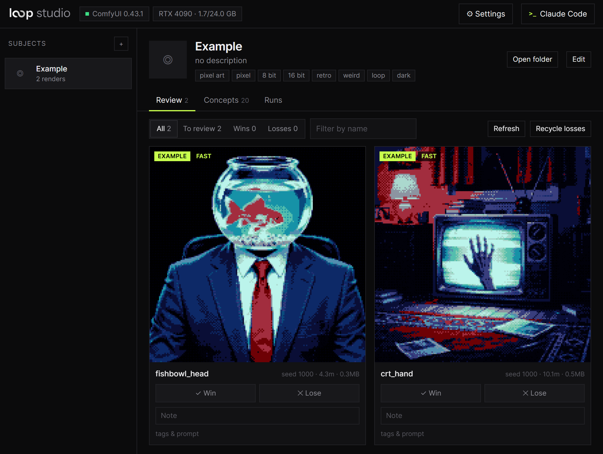

<p align="center">
  <picture>
    <source media="(prefers-color-scheme: dark)" srcset="static/logo/wordmark.svg">
    <source media="(prefers-color-scheme: light)" srcset="static/logo/wordmark-light.svg">
    
  </picture>
</p>

<p align="center">
  
  
</p>

A local web app for making seamless looping GIFs (memes, reactions, art loops) with **MiniMax H3** on your own **ComfyUI**, with a
coding agent of your choice built into a terminal drawer.



## Easy setup

Windows with an NVIDIA GPU (24 GB recommended) and about 45 GB free for the models.

1. Install [ComfyUI](https://github.com/comfyanonymous/ComfyUI) v0.42 or newer, and start it.
2. Install [Python 3.12 or newer](https://www.python.org/downloads/).
3. Download this repo and run **`start.bat`**. The browser opens by itself. Pick your ComfyUI folder when it asks.
4. Open **⚙ Settings → Requirements**:
   - press **Install** on every row that has the button (gifski, Python packages, node packs)
   - press **Download the … missing for default renders** and wait for the files to finish
   - restart ComfyUI, then press **Check again**: the required rows should all show ✓
5. Open the **example** subject, go to **Concepts**, pick one and press **Render**. A render takes about 15 minutes on an
   RTX 4090, and lands in the **Review** tab.

Whether you may use the models, and what you may do with what you make, is yours to check: see the
[MiniMax H3 Community License](https://huggingface.co/MiniMaxAI/MiniMax-H3/blob/main/LICENSE).

## What it does

- **Subjects**: a character from a reference image (a person, a pet, a cartoon), or a pure style with no reference.
- **Concepts**: one GIF idea each (action, caption, sound, tags), with a live prompt preview.
- **Render queue** with live ComfyUI progress. Every render is a 102-frame seamless loop in 1:1 (992×992), 9:16 (704×1280)
  or 16:9 (1280×704): an MP4 + PNG frames, plus a GIF, animated WebP and/or a shareable captioned MP4. By default H3
  renders with the Pika H3 Flex and VBVR LoRAs stacked on it ([MODELS.md](MODELS.md) has the other options to compare).
- **Review grid**: Win/Lose marks and notes, tags, filters.
- **Agent terminal**: Claude Code, Codex, Gemini CLI, OpenCode, Aider, or anything else that runs in a terminal, including
  agents on a local model. It reads `AGENTS.md`, sees what you have open, and can write concepts, queue renders, look at
  frames and fix losing loops for you.

---

# Detailed setup

Windows only for now (the terminal uses ConPTY via pywinpty; Recycle Bin and paths are Windows').

## What you need

1. **ComfyUI** v0.42+ with an NVIDIA GPU (24 GB recommended). The models and nodes it needs can come later: Loop
   Studio downloads and installs them for you (see below). In total:
   - the MiniMax H3 model, text encoder and video/audio VAEs, plus the Pika H3 Flex and VBVR LoRAs of the default
     render: about **44.6 GB**
   - the [ComfyUI-MiniMaxH3-Loop](https://github.com/pxl-pshr/ComfyUI-MiniMaxH3-Loop) custom node
   - optional: FastH3 Omni for fast renders (22.2 GB), the MiniMax H3 latent upscaler (0.7 GB + its node pack)
   - `opencv-python-headless` in ComfyUI's Python: Settings → Requirements has an Install button for it, and renders
     wait until it's there

   [MODELS.md](MODELS.md) lists each file with its size, its direct download link and the ComfyUI folder it goes in.
2. **[gifski](https://gif.ski)**, which makes the GIFs. The **Install** button in Settings → Requirements gets it for
   you, into Loop Studio's own `tools/` folder, and it doesn't need Rust. To do it by hand, download
   [the zip](https://gif.ski/gifski-1.32.0.zip) and copy `win\gifski.exe` from it into a folder on PATH, such as
   `%LOCALAPPDATA%\Microsoft\WindowsApps`. Don't use its `.msi` or winget: that installer has no PATH entry, so Loop
   Studio can't find the `gifski` command. If you turn GIF off in Outputs, you don't need it.
3. **Python 3.12 or newer** for the app itself ([python.org](https://www.python.org/downloads/)); `start.bat` makes
   its venv on first run.
4. An **agent CLI** on PATH if you want the terminal agent, e.g.
   [Claude Code](https://docs.claude.com/en/docs/claude-code) (`claude`, the default). Everything else works without one.

## Settings

Run `start.bat` (ComfyUI must be running; the browser opens once the app is up). First it asks for your **ComfyUI
folder**, offering any it finds on the PC. Then open **⚙ Settings** for the rest:

- **Requirements**: what your ComfyUI has and what it's missing. A missing model has a **Download** button that saves
  it straight into a ComfyUI folder you pick, from every folder ComfyUI reads (`extra_model_paths.yaml` included, e.g. a
  NAS). Downloads go one at a time and resume if stopped, also after the app restarts. A missing node pack has an
  **Install** button (restart ComfyUI after). **Download the … missing for default renders** gets everything a first
  render needs.
- **Folders**: your ComfyUI folder (its Python is found automatically: `venv`, `.venv` or the portable `python_embeded`)
  and the subjects folder, where each subject's folder holds its settings, concepts, marks and render history (a
  separate run data folder is optional). *Browse…* opens a folder picker; **Open folder** on a subject and **Show in
  folder** on a render open them in Explorer.
- **Outputs**: GIF, animated WebP and/or MP4, size, 12 or 24 fps, captions on/off.
- **Agent**: pick a preset or type any command, plus environment variables for it (see below).

Settings are saved in `config.json` (see `config.example.json`). Changes apply as soon as they're saved, also when `config.json` is edited by hand; a new agent starts when you press the terminal's Restart.

**On first run** a welcome offers to have your agent check the setup: it runs `python studio.py models` (which render
modes this ComfyUI can run, what's missing for the others, and minutes per GIF: this PC's own timings once it has
some, else RTX 4090 figures), recommends a mode and asks before rendering anything.

**Settings → Requirements** checks the running ComfyUI: its version, the H3 nodes, the Loop node and every model,
wherever ComfyUI finds it. Optional ones are marked with what they're for. Renders that can't run are refused with the
list of what's missing. The same model and node check runs from a terminal: `python skill/scripts/needs.py [comfy url]`.

**Tests**: `.venv\Scripts\python.exe -m unittest discover tests` checks the render and review scripts on the bundled
example subject (dry runs, seed picking, the default LoRA stack and what each mode needs; no ComfyUI needed).

## Using your own agent / model

The terminal runs whatever command you set. Everything the agent needs is in plain files, so any agent works:

- `AGENTS.md`: how to drive the app (`python studio.py state|render|refresh|runs|stop|models|onboarded`). Claude Code
  reads it through `CLAUDE.md`; Codex, OpenCode, Gemini CLI (`"contextFileName": "AGENTS.md"` in `.gemini/settings.json`)
  and Aider (`--read AGENTS.md`) can read it directly.
- `skill/SKILL.md` + `skill/PROMPTING.md`: the pipeline and how to write prompts that loop. `skill/` is also a valid
  Claude Code skill folder, used where it is (its scripts read Loop Studio's `config.json`).

Examples (Settings → Agent):

| Agent | Command | Environment |
|---|---|---|
| Claude Code | `claude` | |
| Codex | `codex` | |
| Gemini CLI | `gemini` | |
| OpenCode (any provider, incl. local) | `opencode` | configured in OpenCode |
| Claude Code on a local model via Ollama | `claude` | `ANTHROPIC_BASE_URL=http://localhost:11434`, `ANTHROPIC_AUTH_TOKEN=ollama`, `ANTHROPIC_MODEL=qwen3-coder` |
| Aider on Ollama | `aider --model ollama_chat/qwen3-coder --read AGENTS.md` | `OLLAMA_API_BASE=http://127.0.0.1:11434` |
| No agent | `powershell` | |

You can also skip the agent entirely: everything (subjects, concepts, renders, review) works from the UI.

## Layout

```
server.py, static/      the app (aiohttp + plain JS), binds to 127.0.0.1 only
studio.py               CLI the agent uses to drive the app
skill/SKILL.md          pipeline + meme concept tips;  skill/PROMPTING.md  H3 loop prompting guide
MODELS.md               the models, LoRAs and upscalers to render with, and how to try each
skill/scripts/          loop_gifs.py (render, GIF/WebP), review.py (loop metrics), recycle.py (Losses), config.py,
                        needs.py (what ComfyUI needs; Settings > Requirements)
skill/subjects/         one folder per subject (yours are git-ignored; `example` ships with the repo)
data/                   run data per subject: marks, render history (git-ignored)
```

The app serves only to 127.0.0.1 and refuses cross-origin requests, because the terminal is a real shell.

## License

Loop Studio's own code is under the [MIT License](LICENSE). It doesn't include the models, which have their own licenses.

Third-party:

- [xterm.js](https://github.com/xtermjs/xterm.js) and its fit addon, in `static/vendor/` (MIT, see `static/vendor/LICENSE-xterm.txt`)
- [gifski](https://gif.ski) (AGPL-3.0 or later) isn't part of this repo: it's a separate program you install, and Loop
  Studio runs it to make GIFs.
- Rendering uses [ComfyUI](https://github.com/comfyanonymous/ComfyUI) over its HTTP API, plus MiniMax H3 and the models
  in [MODELS.md](MODELS.md).
